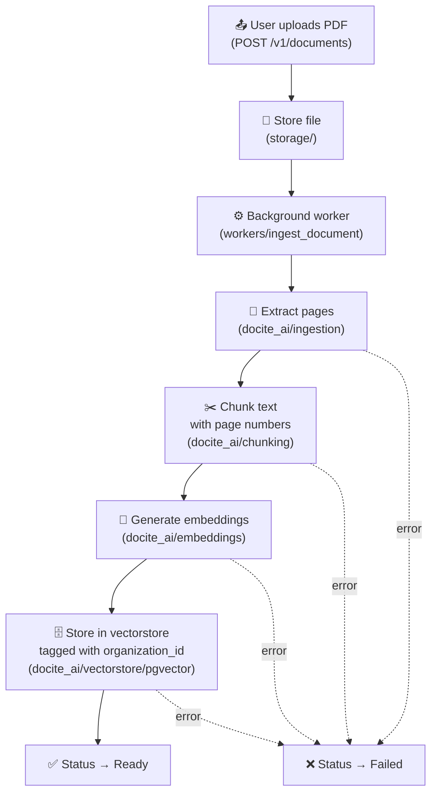
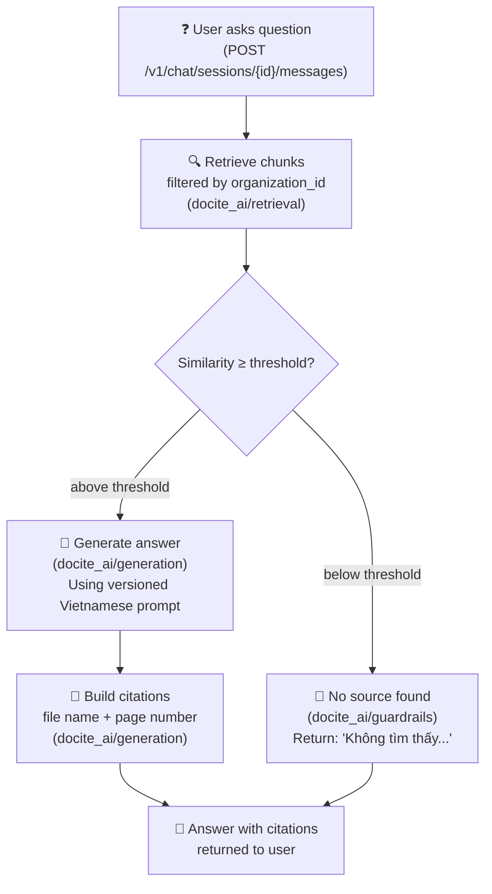

# docs/architecture.md — Docite System Architecture

## Overview

Docite is a multi-tenant Document QA SaaS.  
Each organization uploads PDFs; users ask questions; the AI answers **only** from that organization's documents, citing file name and page number.  
One organization must never see another's data.

## Boundary Rules

| Rule | Description |
|------|-------------|
| **HTTP only** | `web` ↔ `api` communicate exclusively over HTTP following `docs/api-contract.md` |
| **Layer discipline** | `api/` routers → `services/` → `repositories/` (DB). No skipping layers. |
| **AI isolation** | `ai/` never imports FastAPI, SQLAlchemy, or anything from `apps/api`. |
| **Org scoping** | Every tenant-data function in `repositories/` and `ai/vectorstore/` takes `organization_id` as a **required** parameter with **no default**. |
| **Prompt versioning** | All prompts are files in `ai/src/docite_ai/prompts/`; never inline strings. |
| **No secrets in repo** | `.env.example` only; all config via pydantic-settings. |
| **Synthetic data only** | No real tenant documents or org names in git. |

---

## Diagram A — Document Ingestion Pipeline

---

## Diagram B — Question Answering Pipeline

